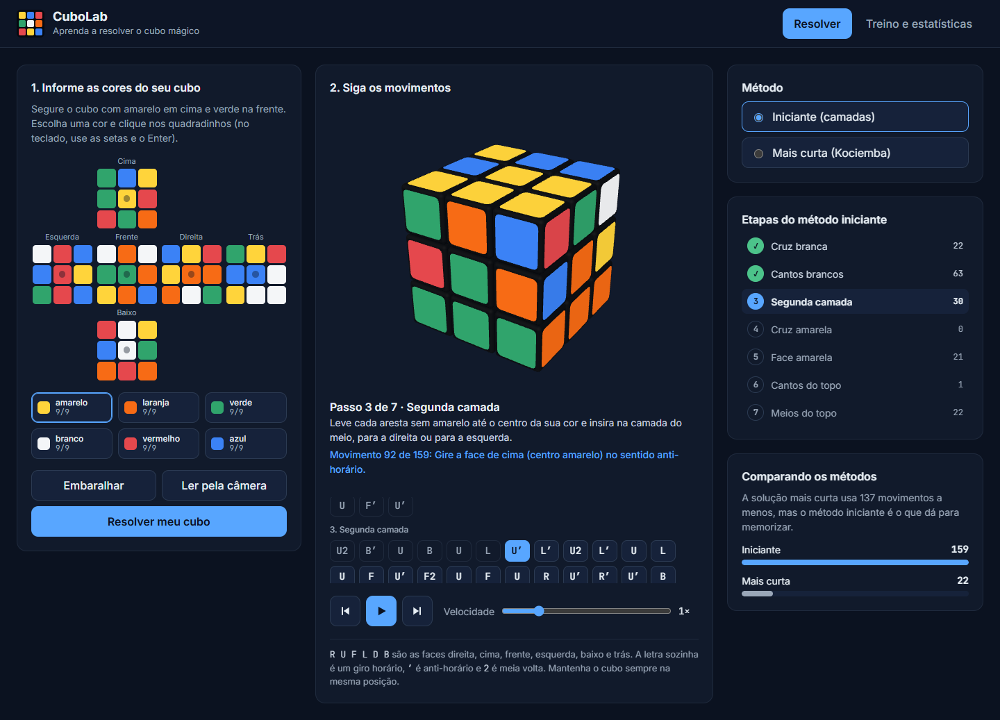
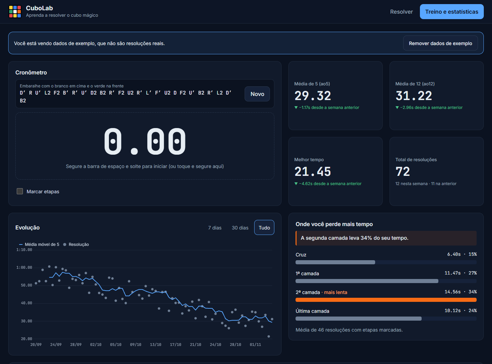

# CuboLab

Aplicação web que ensina a resolver o cubo mágico 3x3 passo a passo e acompanha a evolução de quem treina.

**[Abrir a demo](https://gustavo-pereiraa.github.io/cubolab/)**





## O que o projeto faz

### Resolver

- **Informe as cores do seu cubo:** pinte um cubo aberto, gere um embaralhamento aleatório ou leia as faces pela webcam.
- **Validação:** antes de resolver, confere a contagem de cores, as peças possíveis, a orientação de cantos e arestas e a paridade, explicando o que está errado.
- **Cubo 3D:** gire a visão com o mouse ou o dedo e veja cada movimento animado.
- **Dois métodos:** o iniciante (por camadas), com 7 etapas e instruções em português, e o mais curto (Kociemba), com a comparação de movimentos entre os dois.
- **Player:** voltar, reproduzir, avançar e ajustar a velocidade, com a sequência de movimentos sempre visível.

### Treino e estatísticas

- **Cronômetro:** segure a barra de espaço (ou o dedo), solte para iniciar e aperte de novo para parar. Marcar etapas registra os tempos parciais.
- **Médias:** ao5 e ao12 pela regra da WCA, melhor tempo e variação em relação à semana anterior.
- **Evolução:** cada resolução como ponto e a média móvel de 5 como linha, com filtro de período.
- **Onde você perde mais tempo:** tempo médio por etapa, com a mais lenta destacada e uma dica automática.
- **Histórico:** tabela das últimas resoluções, penalidades (+2 e DNF), exclusão e exportação em CSV.

Sem histórico, a tela oferece **dados de exemplo** para mostrar as estatísticas preenchidas. Eles são fictícios, ficam identificados na tela e podem ser removidos sem afetar resoluções reais. O print acima usa esses dados.

Os dados ficam só no `localStorage` do navegador, e as imagens da câmera nunca saem dele. Não há back-end.

## Tecnologias

| Uso | Tecnologia |
|---|---|
| Base | [Vite](https://vite.dev/) e JavaScript (ES modules), sem framework de UI |
| Cubo 3D | [Three.js](https://threejs.org/) |
| Solução mais curta | [cubejs](https://github.com/ldez/cubejs) (algoritmo de Kociemba), em um Web Worker |
| Gráficos | [Chart.js](https://www.chartjs.org/) |
| Testes | [Vitest](https://vitest.dev/) |
| Publicação | GitHub Pages, via GitHub Actions |

## Ciência de dados no projeto

### K-means na leitura das cores

O problema de ler cores com limites fixos é a iluminação: sob uma lâmpada amarela, o branco parece amarelo, e na sombra o laranja parece vermelho. Por isso, o CuboLab não compara cada cor com uma tabela. Ele analisa as 54 cores **em conjunto** e deixa os grupos saírem das próprias amostras, que estão todas sob a mesma luz.

1. **Amostragem:** de cada quadradinho sai a mediana de cada canal, que ignora bordas e reflexos pequenos.
2. **Espaço de cor:** as cores vão para o espaço CIE Lab, onde a distância acompanha a diferença percebida pelo olho.
3. **Normalização:** `a` e `b` são divididos por `L + 16`, o que torna a cor quase imune à exposição, e o brilho recebe peso menor.
4. **K-means:** o agrupamento em 6 clusters começa nos centros das faces, cuja cor já é conhecida, e isso também dá nome a cada cluster.
5. **9 de cada cor:** o k-means pode formar grupos desiguais, como 11 vermelhos e 7 laranjas. O [algoritmo húngaro](src/vision/assignment.js) redistribui os adesivos em exatamente 9 por cor, com a menor distância total.
6. **Incerteza:** adesivos quase tão próximos de uma segunda cor ficam tracejados, e qualquer quadradinho pode ser corrigido à mão.

#### Resultados em simulação

> **Estes números vêm de iluminação simulada, não de fotos reais.** A leitura ainda não foi medida com uma webcam e um cubo físico, e o resultado real tende a ser menos perfeito.

Porcentagem de adesivos classificados corretamente em 200 cubos por cenário, comparando com uma paleta fixa (cada adesivo vai para a cor mais próxima da paleta):

| Iluminação simulada | K-means | Paleta fixa |
|---|---|---|
| Neutra | 100% | 100% |
| Pouca luz | **100%** | 50,0% |
| Luz quente e fraca, com exposição variável | **100%** | 54,0% |
| Luz quente | **100%** | 83,4% |
| Exposição diferente em cada face | **100%** | 93,3% |
| Luz fria | **100%** | 97,2% |
| Reflexo cobrindo adesivos inteiros | 91,2% | **94,9%** |

O último cenário é a limitação conhecida: quando um reflexo cobre o adesivo inteiro, a cor real se perde. Os cenários estão em [`tests/vision/lighting.js`](tests/vision/lighting.js).

### Métricas de evolução

- **Médias WCA (ao5 e ao12):** descartam o melhor e o pior tempo e tiram a média dos demais, o que reduz o efeito de resoluções atípicas. Um DNF conta como o pior tempo, e dois ou mais tornam a média DNF. Um +2 é somado antes do descarte.
- **Média móvel de 5:** aplica a mesma regra a cada janela de 5 resoluções. É calculada sobre todo o histórico antes de filtrar o período, então o início do gráfico já vem com o valor certo.
- **Variação semanal:** compara cada métrica de hoje com o que ela era há 7 dias. Sem dados suficientes, a tela diz isso em vez de mostrar uma variação inventada.
- **Tempo por etapa:** média de cada etapa nas resoluções com parciais, ignorando DNF, com a participação no tempo total.
- **Exportação:** o CSV traz os tempos em milissegundos, pronto para análise em pandas ou R.

## Como funciona o resolvedor

- **Modelo:** o cubo é um vetor de 54 adesivos, e os movimentos são derivados da geometria, em vez de tabelas digitadas à mão. Os testes conferem os 18 movimentos contra a `cubejs`.
- **Método iniciante:** simula o cubo e aplica os algoritmos clássicos de cada etapa, adaptados à face certa para a pessoa não precisar girar o cubo nas mãos. Os testes rodam 1000 embaralhamentos e conferem o objetivo de cada etapa. Em uma amostra de 3000, a média foi de 146 movimentos.
- **Solução mais curta:** usa uma busca bidirecional própria, com a solução mínima garantida para cubos a até 8 movimentos, onde a `cubejs` desperdiça movimentos. Acima disso, usa o Kociemba, que entrega no máximo 22 movimentos, mas sem garantia de ser a menor solução possível.

Na tela Resolver, o cubo fica com **amarelo em cima e verde na frente**, para o método terminar com o amarelo no topo. Os embaralhamentos do cronômetro seguem o padrão WCA, com **branco em cima e verde na frente**.

## Como rodar localmente

É preciso ter o [Node.js](https://nodejs.org/) 24 ou mais recente.

```bash
git clone https://github.com/gustavo-pereiraa/cubolab.git
cd cubolab
npm install
npm run dev
```

Depois, abra `http://localhost:5173/cubolab/`.

| Comando | O que faz |
|---|---|
| `npm run dev` | Inicia o servidor de desenvolvimento |
| `npm test` | Roda os testes |
| `npm run build` | Gera a versão de produção em `dist/` |
| `npm run preview` | Serve a versão de produção localmente |

## Estrutura

```text
src/
├─ cube/     modelo, movimentos, notação e validação
├─ solver/   método iniciante e Kociemba
├─ vision/   Lab, k-means, algoritmo húngaro e amostragem da câmera
├─ stats/    cronômetro, armazenamento, métricas e CSV
├─ three/    cena 3D e animação
├─ ui/       telas e componentes
└─ styles/   tema e estilos
tests/       testes da lógica, espelhando src/
stubs/       substituto vazio do npm, que a cubejs declara como dependência sem usar
```

## Limitações conhecidas

- A leitura pela câmera só foi testada com vídeo simulado, ainda não com uma webcam e um cubo reais.
- Em celulares, os quadradinhos do cubo aberto têm cerca de 24px, abaixo dos 44px recomendados, para a cruz caber inteira na tela.
- O giro da visão do cubo 3D funciona com mouse e toque, mas não com teclado. A sequência de movimentos e os controles do player funcionam com teclado.
- O CSV usa vírgula como separador. No Excel em português, pode ser preciso usar "Texto para Colunas" ou a importação de dados.
